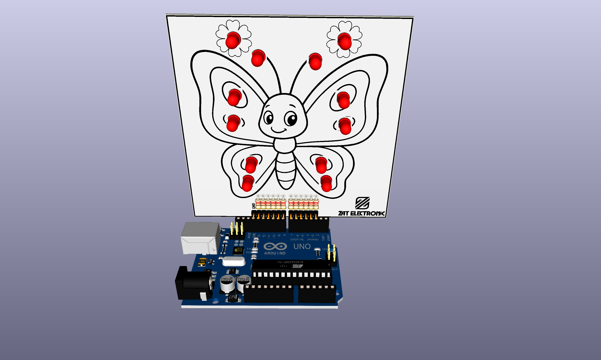
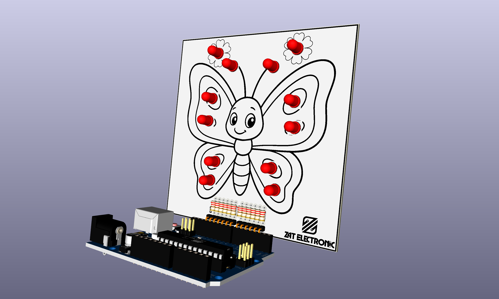

# BORBOLETA — shield de LEDs para Arduino UNO

Uma borboleta desenhada na serigrafia com **12 LEDs vermelhos** de 5 mm nas asas. A placa encaixa como **shield no Arduino UNO R3** (barra digital D2–D13 + GND) e cada LED é um pino do Arduino.

<p align="center">
  
  
</p>

## Funcionalidades

- ✅ **Shield Arduino UNO R3** (A1) — só a barra digital D2–D13 + GND (não usa 5 V, 3,3 V nem analógicos)
- ✅ **12 LEDs 5 mm vermelhos** THT (D1–D12), um por pino digital
- ✅ **12 resistores 220 Ω 1/4 W** axiais (R1–R12), um por LED
- ✅ **Arte na serigrafia** recortada em volta de cada LED (nada de tinta sobre pad)
- ✅ Placa **100 × 100 mm**, 2 camadas, plano de GND nas duas faces

## Ligação dos LEDs

| LED | Cor | Resistor | Pino do Arduino | Corrente @ 5 V |
|---|---|---|---|---|
| D1 | vermelho | R1 220 Ω | D2 | ≈ 13,6 mA |
| D2 | vermelho | R2 220 Ω | D3 | ≈ 13,6 mA |
| D3 | vermelho | R3 220 Ω | D4 | ≈ 13,6 mA |
| D4 | vermelho | R4 220 Ω | D5 | ≈ 13,6 mA |
| D5 | vermelho | R5 220 Ω | D6 | ≈ 13,6 mA |
| D6 | vermelho | R6 220 Ω | D7 | ≈ 13,6 mA |
| D7 | vermelho | R7 220 Ω | D8 | ≈ 13,6 mA |
| D8 | vermelho | R8 220 Ω | D9 | ≈ 13,6 mA |
| D9 | vermelho | R9 220 Ω | D10 | ≈ 13,6 mA |
| D10 | vermelho | R10 220 Ω | D11 | ≈ 13,6 mA |
| D11 | vermelho | R11 220 Ω | D12 | ≈ 13,6 mA |
| D12 | vermelho | R12 220 Ω | D13 | ≈ 13,6 mA |

Cada canal: **pino → 220 Ω → LED → GND** (nível alto acende). Todos acesos ≈ **163 mA** — dentro do limite do UNO (≈ 200 mA no total), mas evite deixar os 12 acesos por muito tempo.

## Diagrama de blocos

```
┌──────────────────────┐  ARD_D2 … ARD_D13  ┌──────────────────────────┐
│  Arduino UNO R3 (A1) │ ─────────────────► │ 12 × [220 Ω → LED 5 mm]  │
│  barra D2–D13 + GND  │ ◄──────── GND ──── │  R1–R12      D1–D12      │
└──────────────────────┘                    └──────────────────────────┘
```

## Firmware

`firmware/BORBOLETA/BORBOLETA.ino` — exemplo simples (corrida, pisca alternado e aleatório).

## Esquemático (KiCad 10)

| Pág. | Folha | Conteúdo |
|---|---|---|
| 1 | Capa (A2) | blocos, mapa dos LEDs na placa, vista 3D |
| 2 | ARDUINO | A1 (shield UNO R3) + PWR_FLAG do GND |
| 3 | LEDS | D1–D12 + R1–R12 |

## Lista de materiais

| Ref. | Qtd | Valor | Footprint |
|---|---|---|---|
| A1 | 1 | Arduino UNO R3 (encaixe) | ZAT_Board_Arduino:Uno_R3_Shield_D2-D13 |
| D1–D12 | 12 | LED 5 mm vermelho | ZAT_LED:LED_D5.0mm_Red |
| R1–R12 | 12 | 220 Ω 1/4 W | ZAT_Resistor_THT:R_Axial_DIN0204_L3.6mm_D1.6mm_P7.62mm_Horizontal_220R |

## Arquivos

- `BORBOLETA.kicad_pro` — projeto KiCad 10 (bibliotecas globais KiCad + ZAT, sem pasta lib)
- `Zat_TitleBlock.kicad_wks` — moldura Zat Electronic
- `packages3D/` — modelos 3D usados na vista 3D

## Licença / autor

Projeto **Zat Electronic** — Kenneth Zat · Osasco/SP · hardware aberto.

*Revisão R01 — 2026-11-12 — KiCad 10.*
